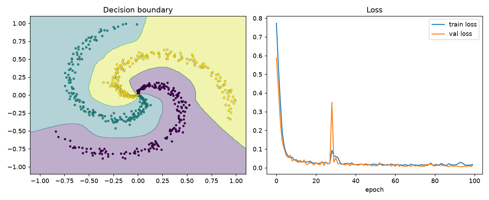
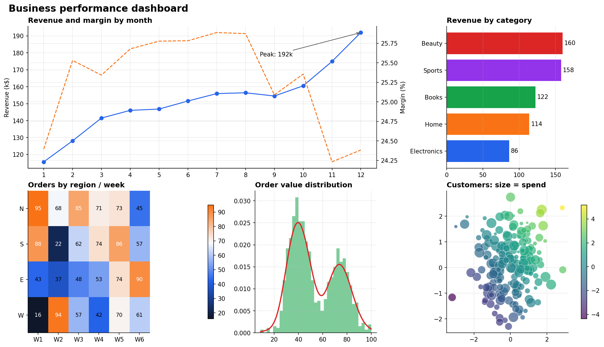

# Python Libraries Portfolio

Four independent, tested, portfolio-grade projects. Each one goes deep on a single core Python
data library and follows the same professional layout: `src/` package, `tests/`, `README`,
`requirements.txt`, `pyproject.toml` and reproducible outputs.

[](https://github.com/<your-username>/python-libraries/actions)

| Project | Library | What it shows |
|---------|---------|---------------|
| [numpy-deep-learning-from-scratch](numpy-deep-learning-from-scratch) | **NumPy** | A neural-network library (Dense, Conv2D, MaxPool, BatchNorm, Dropout, Adam) with hand-written backprop, verified by numerical gradient checks |
| [pandas-sales-analytics](pandas-sales-analytics) | **pandas** | Cleaning a messy dataset, joins, resampling, pivots, RFM segmentation, cohort retention, memory optimisation |
| [matplotlib-visualization-gallery](matplotlib-visualization-gallery) | **Matplotlib** | Multi-panel dashboards, 3-D surfaces, polar charts, animations, custom styles and colormaps |
| [sklearn-churn-prediction](sklearn-churn-prediction) | **scikit-learn** | Leak-free pipelines, custom transformers, cross-validation, hyper-parameter search, calibration, explainability |

<p>


</p>

## Running a project

```bash
git clone https://github.com/<your-username>/python-libraries.git
cd python-libraries/<project-folder>
python -m venv .venv && source .venv/bin/activate     # Windows: .venv\Scripts\activate
pip install -r requirements.txt
pip install -e .
pytest
```

Every project is self-contained and uses synthetic or built-in data, so no downloads are needed.

## Repository structure

```
python-libraries/
├── numpy-deep-learning-from-scratch/
├── pandas-sales-analytics/
├── matplotlib-visualization-gallery/
├── sklearn-churn-prediction/
├── .github/workflows/ci.yml      # runs every project's tests
├── LICENSE
└── README.md
```

## Author

Mostamir Kazimi, full-stack web developer with Python and AI/ML experience.

## License

MIT
