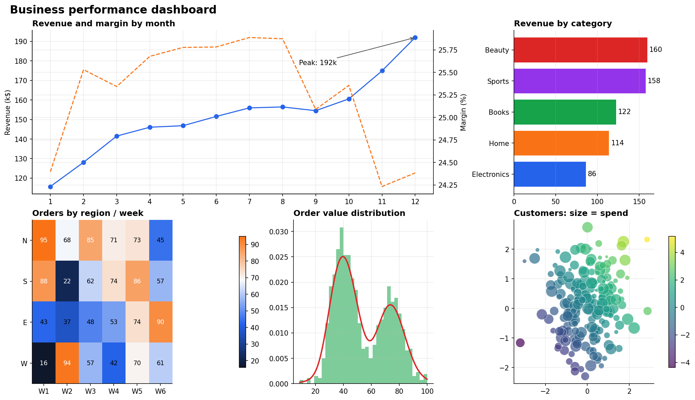
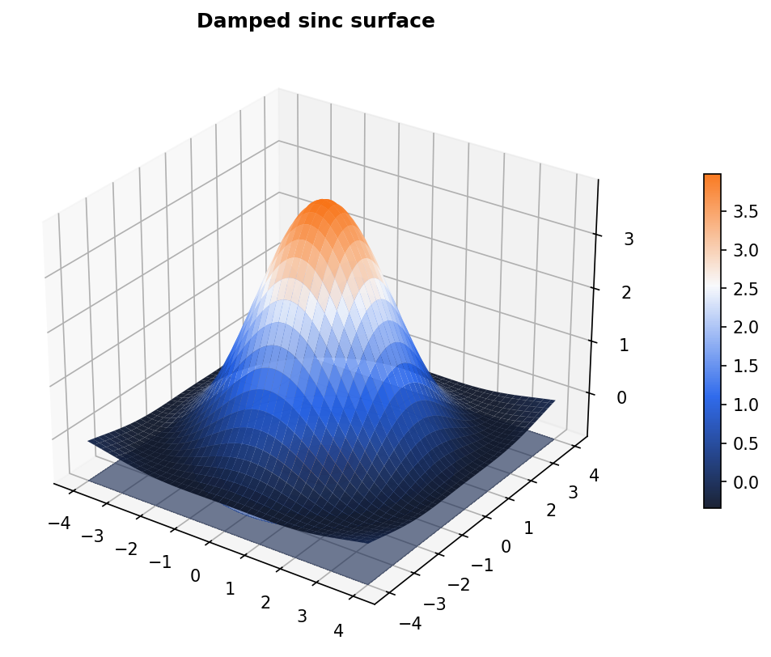
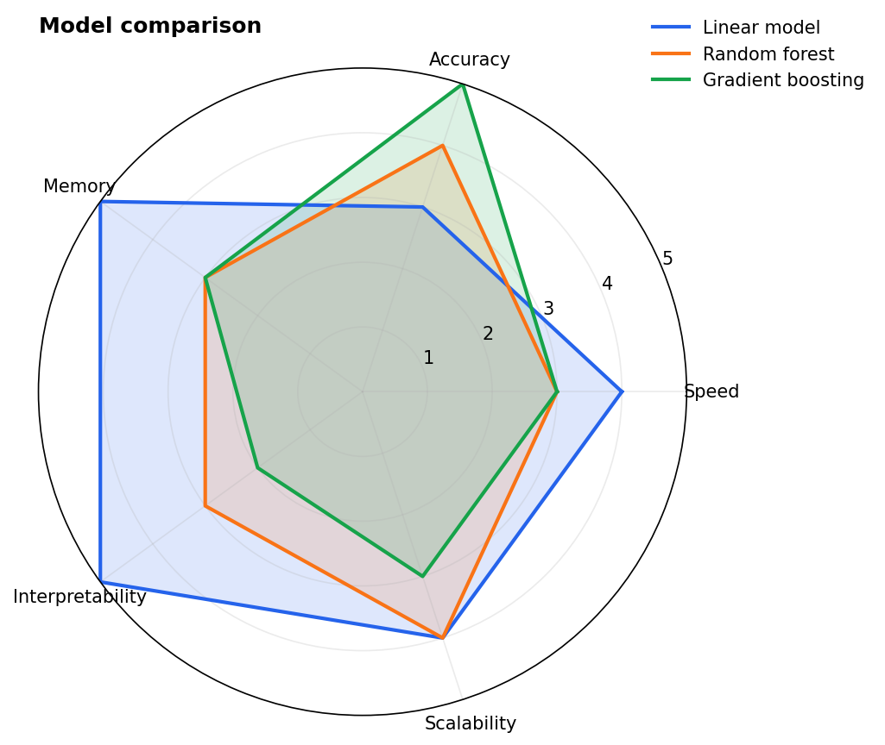
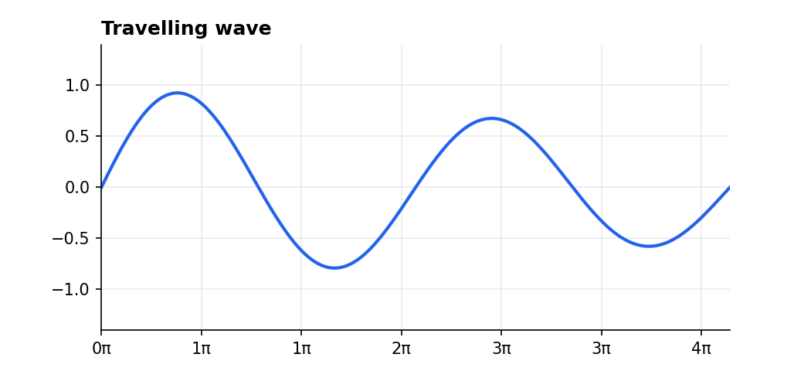

# mplx: Advanced Matplotlib Visualization Gallery

Reusable, publication-quality figures built with Matplotlib's object-oriented API.
Each function returns a `Figure`, so it is easy to test, save and embed.



| Figure | Techniques |
|--------|-----------|
| `business_dashboard()` | `subplot_mosaic`, `constrained_layout`, twin axes, `annotate` with arrows, `bar_label`, annotated heatmap, histogram with a NumPy KDE (Silverman bandwidth), bubble scatter with colorbar |
| `surface_3d()` | 3-D surface, projected contour, custom camera angle |
| `radar_chart()` | polar projection, closed polygons, filled areas |
| `animate_wave()` | `FuncAnimation` with blitting, exported as a GIF using `PillowWriter` |
| `style.py` | global `rcParams` theme, `cycler`, custom `LinearSegmentedColormap` |

<p>


</p>



## Run it

```bash
pip install -r requirements.txt
pip install -e .
python scripts/generate_all.py     # regenerates everything in outputs/
pytest
```

```python
from mplx import business_dashboard
fig = business_dashboard()
fig.savefig("my_dashboard.png")
```
