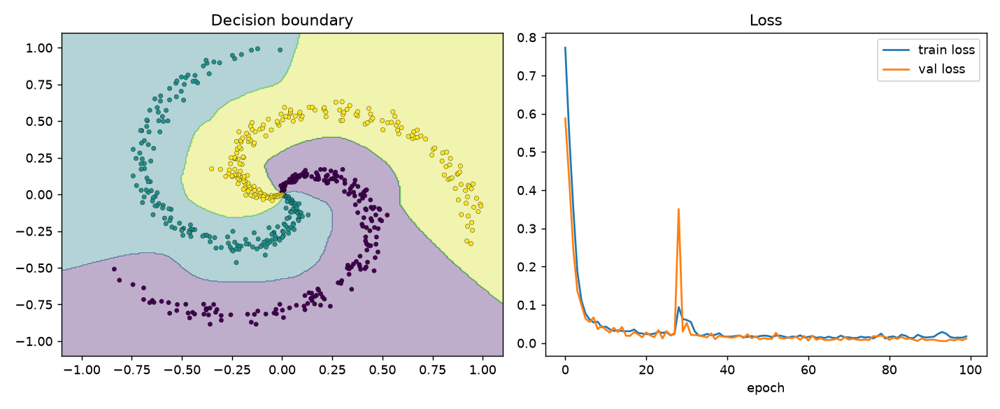
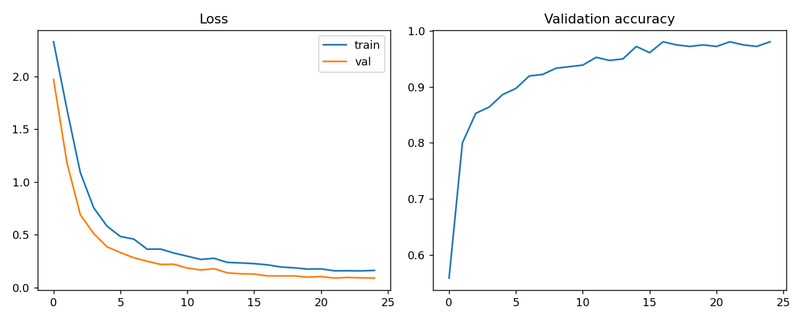

# npdl: Deep Learning from Scratch with NumPy

A small neural-network library written **only with NumPy**: no PyTorch, no TensorFlow, no autograd.
Every forward and backward pass is derived and implemented by hand, then verified against numerical gradients.



## Features

| Area | What is implemented |
|------|---------------------|
| Layers | `Dense`, `Conv2D`, `MaxPool2D`, `Flatten`, `BatchNorm1D`, `Dropout` |
| Activations | `ReLU`, `Tanh`, `Sigmoid` |
| Loss | Numerically stable fused `SoftmaxCrossEntropy` (log-sum-exp trick) |
| Optimizers | `SGD` with momentum, `Adam`, both with L2 weight decay |
| Training API | Keras-like `Sequential.fit / predict / evaluate`, mini-batches, history |
| Correctness | Finite-difference **gradient checking** for every layer, plus unit tests |

## Advanced NumPy techniques used

- **Vectorisation and broadcasting**: no Python loops over samples or pixels.
- **`np.lib.stride_tricks.sliding_window_view`**: zero-copy sliding windows for convolution.
- **`np.einsum`** (with `optimize=True`): the convolution forward pass, and the weight and input gradients.
- **Reshape tricks**: max pooling without loops, with ties split evenly in the backward pass.
- **Numerical stability**: max-subtraction in softmax, clipping in sigmoid.
- **In-place parameter updates** shared between layers and optimizers.
- **`np.random.default_rng`**: reproducible random generators everywhere.
- **`np.nditer`**: a generic finite-difference gradient checker.

## Project structure

```
src/npdl/        library code (layers, losses, optimizers, model, utils)
tests/           gradient checks and training tests
examples/        spiral MLP and digits CNN scripts
outputs/         generated plots
```

## Installation

```bash
git clone https://github.com/<your-username>/python-libraries.git
cd python-libraries/numpy-deep-learning-from-scratch
pip install -r requirements.txt
pip install -e .
```

## Quick start

```python
from npdl import Sequential, Dense, ReLU, Adam, SoftmaxCrossEntropy
from npdl.utils import make_spirals, train_test_split

X, y = make_spirals(200, 3)
Xtr, Xte, ytr, yte = train_test_split(X, y)

model = Sequential([Dense(2, 64), ReLU(), Dense(64, 64), ReLU(), Dense(64, 3)])
model.fit(Xtr, ytr, SoftmaxCrossEntropy(), Adam(lr=0.01), epochs=100,
          validation=(Xte, yte))
```

Run the examples from the project root:

```bash
python examples/spiral_mlp.py     # MLP on a non-linear dataset, saves boundary plot
python examples/digits_cnn.py     # CNN on 8x8 digits
```

## Results

| Example | Model | Test accuracy |
|---------|-------|---------------|
| Spirals (3 classes) | MLP 2-64-64-3 | about 99% |
| Digits (8x8) | Conv-Pool-Conv-Pool-Dense CNN | about 98% |



## Testing

```bash
pip install pytest
pytest
```

The tests compare each analytic gradient with a central finite difference
(relative error below 1e-5), including strided and padded convolutions.

## How backpropagation is implemented

Each layer caches what it needs during `forward` and returns the gradient with respect to its input in `backward`,
while storing parameter gradients in `layer.grads`. For example, the dense layer computes
`dW = xᵀ·δ`, `db = Σδ`, `dx = δ·Wᵀ`; the batch-norm backward pass uses the closed-form expression
that avoids materialising the full Jacobian.

## Possible extensions

- Learning-rate schedulers and gradient clipping
- `Conv2D` via im2col + GEMM benchmark against the einsum version
- RNN/LSTM layers, residual connections
- A reverse-mode automatic differentiation engine

## License

MIT (see the repository root).
