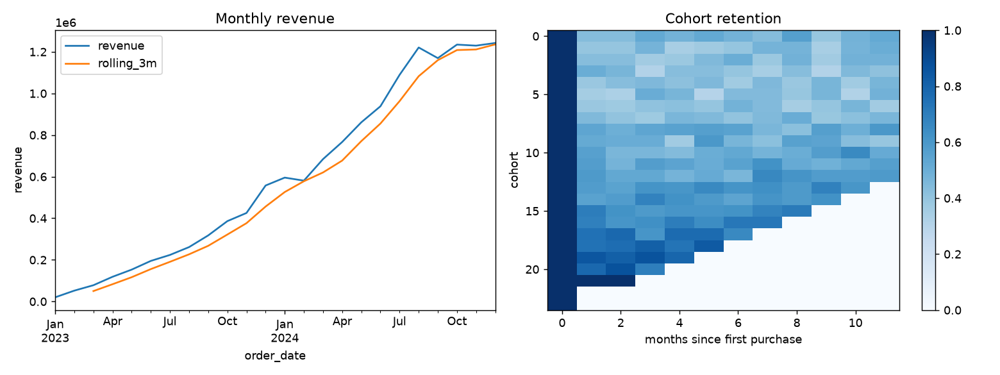

# salesx: Sales Analytics Pipeline with pandas

An end-to-end analytics workflow on a deliberately **messy** synthetic e-commerce dataset:
generate, clean, join, analyse and report, all in idiomatic pandas.



## What it demonstrates

| Topic | Where |
|-------|-------|
| Method chaining with `assign`, `pipe`, `astype` | `cleaning.py` |
| Data cleaning: duplicates, text normalisation, bad dates (`errors="coerce"`), missing values, robust IQR outlier capping | `cleaning.py` |
| Safe joins with `merge(validate=...)` | `cleaning.enrich` |
| Time series: `resample`, `rolling`, `pct_change` | `analysis.monthly_revenue` |
| Named aggregation with `groupby().agg(...)` | `analysis.top_products` |
| `pivot_table` with margins | `analysis.pivot_region_category` |
| RFM customer scoring with `qcut` and `cut` | `analysis.rfm_segments` |
| Cohort retention with `Period`, `transform`, `unstack` | `analysis.cohort_retention` |
| Memory optimisation: downcasting and `category` dtype (about 6x smaller) | `cleaning.optimize_memory` |

## Run it

```bash
pip install -r requirements.txt
pip install -e .
python scripts/run_pipeline.py     # writes outputs/report.md, CSVs and overview.png
pytest
```

## Project layout

```
src/salesx/    data_gen.py, cleaning.py, analysis.py
scripts/       run_pipeline.py
tests/         invariants (revenue totals match, retention starts at 100%, ...)
outputs/       generated report and charts
```

The full generated report is in [`outputs/report.md`](outputs/report.md).
