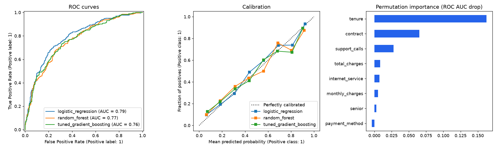

# churnml: Customer Churn Prediction with scikit-learn

A production-style machine-learning workflow: **everything lives inside a single `Pipeline`**,
so there is no data leakage and the whole thing can be saved with one `joblib.dump`.



## What it demonstrates

- **Custom transformer** (`RatioFeatures`) following the full estimator API (`BaseEstimator`, `TransformerMixin`, `get_feature_names_out`)
- **`ColumnTransformer`** with `make_column_selector`: imputation, scaling and one-hot encoding (`handle_unknown="ignore"`)
- **Stratified cross-validation** comparing three models on ROC AUC, average precision and F1
- **`RandomizedSearchCV`** tuning only the model step of the pipeline (`model__learning_rate`, ...)
- **Calibration curves** and ROC curves with `*Display.from_estimator`
- **Permutation importance** computed on raw columns, through the entire pipeline
- Model persistence with `joblib`, metrics saved as JSON

## Results

| Model | CV ROC AUC | Test ROC AUC |
|-------|-----------:|-------------:|
| Logistic regression | 0.817 | 0.793 |
| Random forest | 0.795 | 0.766 |
| Gradient boosting (tuned) | 0.799 | 0.764 |

The data is synthetic and generated from a logistic model, so it is not surprising that
logistic regression wins here. With real, non-linear data, the tree ensembles usually pull ahead.
The workflow is what this project is about, not the leaderboard. See [`outputs/metrics.json`](outputs/metrics.json).

## Run it

```bash
pip install -r requirements.txt
pip install -e .
python scripts/train.py
pytest
```

```python
import joblib
model = joblib.load("outputs/model.joblib")   # created by scripts/train.py
model.predict_proba(new_customers_dataframe)
```

## Layout

```
src/churnml/   data.py, pipeline.py, evaluation.py
scripts/       train.py
tests/         estimator API, unseen categories, performance sanity checks
```
